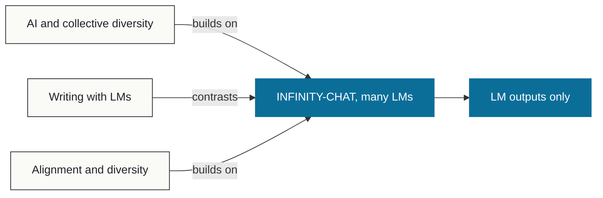
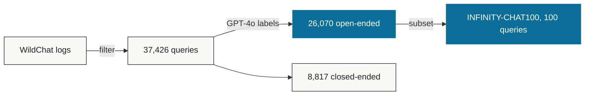
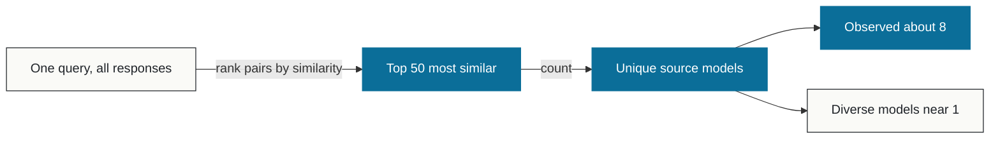
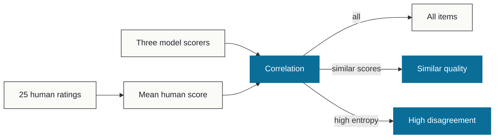
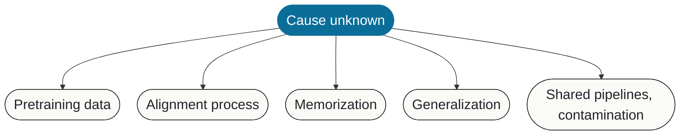
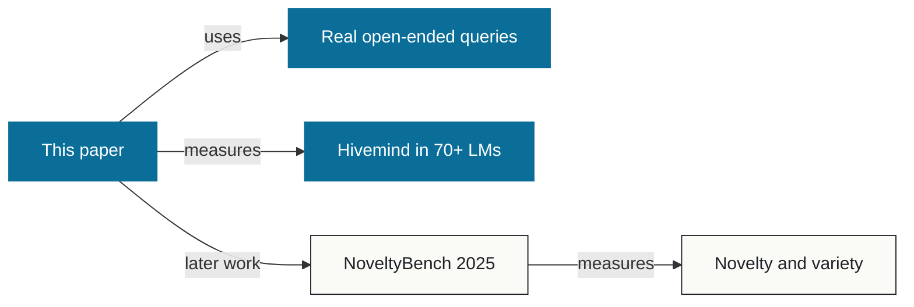

# Artificial Hivemind: The Open-Ended Homogeneity of Language Models (and Beyond)

Real open-ended queries show many LMs giving near-identical answers.

<!--
Welcome. This talk is about a paper called Artificial Hivemind, by Jiang and colleagues. The question is simple. If you ask many language models an open-ended question, one with no single right answer, do you get many different answers? The paper says mostly no. We will look at how the data was built, how repetition is measured, and where the authors see their own limits. First, a concrete example that shows the problem in one picture.
-->

---
layout: claim-figure
---
# Asked for a metaphor about time, many LMs land in the same few clusters

<SourceCaption>Jiang et al., 2025, Fig. 1</SourceCaption>

Query: Write a metaphor about time. 50 responses from each of 25 models, projected with PCA. A big 'time is a river' cluster and a smaller 'weaver' cluster. Cause is left open by the authors.

<!--
Here is the example that opens the paper. The query is: Write a metaphor about time. The authors collected 50 responses from each of 25 models and projected the sentence embeddings down to two dimensions with PCA. Look at the plot. A big cluster on the left says, more or less, 'Time is a river'. gpt-4o-2024-11-20, Qwen2.5-72B-Instruct, phi-4 and gpt-4o-mini-2024-07-18 all begin that way. A smaller cluster on the right says time is a weaver. Meta-Llama-3.1-405B-Instruct-Turbo and phi-4 land there.

Two things are happening at once. One model repeats itself, and that is intra-model repetition. Models from different families land in the same cluster, and that is inter-model homogeneity. Together the authors call this the Artificial Hivemind effect. The worry behind it is that if people lean on these systems, human thinking could also homogenize.

Keep one point in mind. The paper measures the effect and does not find the cause. The authors leave the why open, and we will come back to that near the end. First, let's place the paper next to earlier work.
-->

---
layout: claim-diagram
---

# Earlier work studied homogenization in human writing and alignment; this paper measures it across LMs

<SourceCaption>Prior work as summarized in Jiang et al., 2025, p.2</SourceCaption>

Earlier studies looked at human content or alignment. This paper measures LM outputs on real queries, with no human writer.

<!--
This slide places the paper against earlier work. On the left are three studies. One found that generative AI raises individual creativity but narrows the collective pool of novel content. That is the human-side version of the worry here, so this paper builds on it. A second asked whether writing with language models reduces content diversity. It studies human writers, so this paper contrasts with it. Here there is no human writer in the loop, only model outputs. The third showed that alignment tuning reduces the conceptual diversity of model outputs, and this paper builds on that too, since it points at post-training as one possible factor.

On the right is the paper itself. It uses INFINITY-CHAT, a dataset of real user queries, and compares a large set of models. What is new is the realism of the queries and the breadth of the models. Follow the arrows and read the labels: two arrows say builds on, one says contrasts. Next, how that dataset was built.
-->

---
layout: claim-diagram
---
# INFINITY-CHAT turns real WildChat queries into 26,070 open-ended prompts

<SourceCaption>Jiang et al., 2025, p.3</SourceCaption>

Filter: single-turn GPT-4, English, non-toxic, 15 to 200 characters. Open-ended means many valid answers, not creative.

<!--
Now the dataset. The authors started from WildChat, a log of real conversations between users and chatbots. So these are prompts that people actually typed, not prompts a researcher wrote by hand. They kept single-turn GPT-4 queries in English, non-toxic, between 15 and 200 characters. That left 37,426 queries.

Then GPT-4o labelled each one as open-ended or closed-ended. Open-ended here means there are many plausible answers and no single ground truth. It does not mean creative. A question about benefits of hardwood flooring can be open-ended too. In the end there are 26,070 open-ended and 8,817 closed-ended queries. The open-ended ones form INFINITY-CHAT.

For the later studies the authors use a smaller subset of 100 queries, called INFINITY-CHAT100. So the hivemind results you will see come from those 100 queries, not from all 26,070. Next, how we measure repetition inside one model.
-->

---
layout: claim-figure
---

# Average pairwise embedding similarity shows a model repeating itself: 79% of cases exceed 0.8

<SourceCaption>Jiang et al., 2025, Fig. 3</SourceCaption>

Each cell is the share of queries in one similarity bin. Above 0.8 means very close, not identical. Random pairs only anchor the scale. Embedder: text-embedding-3-small; top-p=0.9, temperature=1.0.

<!--
Now the measure. For one model and one query, we sample 50 responses. We embed each with OpenAI's text-embedding-3-small, take the cosine similarity for every pair of responses, and average. A high average means the model keeps saying the same thing.

The heatmap shows, for each model, how the queries spread across similarity bins. The mass sits in the high-similarity bins, and the paper says that in 79% of cases the average similarity exceeds 0.8.

Three cautions. First, above 0.8 means very close, not identical text. Second, the random-pair similarity is only a reference point for the scale. It is not a matched baseline for same-prompt convergence. Third, the numbers depend on the embedding model the authors picked. The sampling settings are top-p 0.9 and temperature 1.0.

So one model repeats itself a lot. Can different sampling fix that? That is next.
-->

---
layout: claim-table
---

# Min-p at temperature 2.0 still leaves 61.2% of pairs above 0.8

| Setting | Value |
|---|---|
| Default sampling | top-p 0.9, temperature 1.0 |
| Min-p run | temperature 2.0 |
| Pairs above 0.7 | 81% |
| Pairs above 0.8 | 61.2% |

<SourceCaption>Jiang et al., 2025, p.5</SourceCaption>

With far more randomness, most response pairs still stay close.

<!--
The natural fix is more randomness. The baseline uses top-p 0.9 and temperature 1.0. The authors also tried min-p decoding. Min-p is a dynamic strategy that adjusts the sampling threshold based on how confident the model is. In this run the temperature goes up to 2.0, which is a lot more randomness than the default.

Read the table. 81% of response pairs still exceed 0.7 similarity, and 61.2% still exceed 0.8. So turning up the randomness does not remove the repetition.

The paper also notes that min-p suits creative tasks and is less effective for close-ended ones, which is one reason it is not widely adopted. The authors conclude that decoding is only part of the answer and training-time solutions are needed too.

That was one half of the hivemind, a model repeating itself. Now the other half: different models agreeing with each other.
-->

---
layout: claim-split
---

# Different models agree with each other: similarity runs from 71% to 82%

::left::

<SourceCaption>Jiang et al., 2025, Fig. 4</SourceCaption>

::right::
- Each cell averages similarity between two models' responses.
- Brightest pair: DeepSeek-V3 with qwen-max-2025-01-25, 0.82.
- Next: DeepSeek-V3 with gpt-4o-2024-11-20, 0.81.

<!--
This is the inter-model half. Each cell in the heatmap is a pair of models, and the value is the average pairwise similarity between their responses to the same queries. The paper says these averages range from 71% to 82%. That is high for models from different families.

The labels inside the heatmap are small, so I read the key cells out for you on the right. The most similar pairs are DeepSeek-V3 and qwen-max-2025-01-25 at 0.82, and DeepSeek-V3 and gpt-4o-2024-11-20 at 0.81. Look for the brightest cells in the figure.

So models repeat themselves, and they also repeat one another. If you hoped to get variety by asking several different models, this figure says the answers overlap a lot. The next slide gives a second way to count that overlap.
-->

---
layout: claim-diagram
---

# The 50 most similar responses to a query come from about 8 models

<SourceCaption>Our illustration of the measure, Jiang et al., 2025, p.6</SourceCaption>

Responses are compared with each other within one query. Some queries exceed 10 models.

<!--
This slide explains a second measure. Read the diagram left to right. Start with one query. We pool every response that all the models gave to that query and compare those responses with each other, using the same sentence embedding similarity as before. The reference is not the query itself. It is the other responses. We rank by that similarity and keep the 50 most similar ones, the tightest group of near copies.

Then we count how many different models those 50 responses came from. That count is what the blue boxes show.

Here is the confusing part. A bigger count does not mean more diversity. If the models were truly diverse, the 50 closest responses would be one model's own samples, because a model resembles itself most. That gives a count near 1. The paper reports an average of about 8 unique models per top-50 cluster, and some queries go above 10. So the most similar outputs are spread across many models.

A note on the source. We tried to replot this from the appendix tables, but those hold pairwise matrices and cannot give this count. So we show the idea as a diagram and quote the paper's number. Next, the human side of the study.
-->

---
layout: claim-table
---

# Every item is rated by 25 people, so disagreement becomes visible

| Study design | Absolute ratings | Pairwise preferences |
|---|---|---|
| One annotator | Scores a response, 1 to 5 | Prefers one of two, strongly or weakly |
| Per query | 15 responses | 10 response pairs |
| Annotators per item | **25** | **25** |
| Queries | 50 | 50 |
| Labels | 18,750 | 12,500 |

<SourceCaption>Jiang et al., 2025, p.7</SourceCaption>

25 opinions per item give a spread, not just an average.

<!--
Next the human side. The authors collected two kinds of labels, shown as the two columns. For absolute ratings, an annotator scores one response from 1 to 5. Twenty-five annotators score each of 15 responses for each of 50 queries. For pairwise preferences, an annotator compares two responses and says which is better, strongly or weakly. Twenty-five annotators judge each of 10 pairs per query.

The point is the bold row. Annotators per item is 25 in both columns. That gives you a distribution of opinions and not only an average.

HelpSteer3, for comparison, has sparse labels, about 3 annotators per item. That is too few to show disagreement well. With 25 per item we can measure how much people disagree, and that is the next slide.
-->

---
layout: claim-two-figures
---
# High Shannon entropy over the 25 labels signals real disagreement, not bad answers

::left::

<SourceCaption>Jiang et al., 2025, Fig. 5</SourceCaption>
Entropy over the 25 labels per item.

::right::

<SourceCaption>Jiang et al., 2025, Fig. 6</SourceCaption>
High entropy: annotators split. Several answers can be valid, so splits are expected. Both skew high.

<!--
With 25 labels per item, we can compute the Shannon entropy of the label distribution. Low entropy means most annotators picked the same label. High entropy means they split across labels.

Look at the two histograms. The left one is for one kind of label, the right one for the other. Both lean toward the higher end.

A common mistake is to read high entropy as a bad response or sloppy annotators. In open-ended tasks several answers can be valid, so splitting is what you would expect. The authors treat it as genuine disagreement between people. That matters for the next step, where we use these labels to test machine scorers.
-->

---
layout: claim-diagram
---
# Model scorers are compared with the mean of 25 human ratings, not a single label

<SourceCaption>Jiang et al., 2025, p.9</SourceCaption>

Scorers: LM perplexity given the query, reward models, LM judges. Figure captions say Spearman; the text says Pearson.

<!--
Now the test. Can model scorers recognize what humans prefer? There are three kinds. Language models, scored by the perplexity of the response given the query. Reward models, which output a scalar. And LM judges, which are prompted to give a score.

Each item has 25 human ratings, and we compare each scorer to the mean of those 25, not to a single label. The point is to test whether models can see that differently rated responses are of similar quality.

Then we compute correlation on three sets: all items, items where humans gave similar scores, and items with high disagreement. Follow the arrows on the diagram.

One flag on the paper itself. The figure captions say Spearman, while the text says Pearson. We report what the text states and flag the mismatch. Next, the result.
-->

---
layout: claim-two-figures
---

# Scorer-human correlation drops on similar-quality, high-disagreement items

Similar quality means close mean human scores. The drop points to poor calibration.

::left::

<SourceCaption>Jiang et al., 2025, Fig. 7: absolute ratings</SourceCaption>

::right::

<SourceCaption>Jiang et al., 2025, Fig. 8: pairwise preferences</SourceCaption>

<!--
Here is the result in two figures. Left, absolute ratings. Right, pairwise preferences. Each one shows the correlation between model scorers and the mean human rating, on the full set and on stricter subsets.

First, how the subsets are picked. One subset keeps items whose human scores are similar, so quality is about the same across the responses. Another keeps items with high disagreement among the human raters. The appendix tables give the numbers for each subset. The authors say there is no single gold-standard way to choose these subsets, and the alternative choices they report are consistent.

Now look at the curves. The correlation is clearly lower on the similar-quality and high-disagreement subsets than on the full set.

Be careful about what that means. Quality is comparable on these items, so the drop does not say the models are bad overall. It says they are poorly calibrated to fine-grained, idiosyncratic differences. The authors only offer a hypothesis: models are usually trained on examples with clearer, higher-agreement differences. So reward models and judges are least reliable exactly where people disagree. One content slide left: what the authors still do not know.
-->

---
layout: claim-diagram
---

# The authors say the cause of cross-model repetition is still unknown

<SourceCaption>Jiang et al., 2025, p.6</SourceCaption>

Proprietary training details hide the cause. No causal analysis is attempted. Min-p suits creative tasks, less so close-ended ones.

<!--
This slide is only what the authors say about their own limits. The cause of the cross-model repetition is unclear, partly because training details of proprietary models are hidden.

Look at the diagram. The blue box on the left is the open question. Each box to its right is a place the cause could sit: pretraining data, the alignment process, memorization, generalization, and shared data pipelines or contamination. Shared pipelines and contamination from synthetic data are possible explanations and nothing more than that.

A full causal analysis is outside the paper. Future work has to ask which of these branches produces the repetition.

Another limit is that min-p is better for creative tasks and less effective for close-ended ones. So we can describe the effect well and cannot yet explain it. Now a quick check of what you remember.
-->

---
layout: claim-quiz
---

# Check your understanding

1What does the 0.1 to 0.2 similarity of random response pairs tell us?

2Why do about 8 different models in each top-50 cluster show homogeneity?

3Why does high Shannon entropy not mean the responses are bad?

4What if we switched from top-p to min-p sampling?

5What if a different embedding model were used to measure similarity?

6What if reward models are scored only on items where humans disagree?

1Only a reference for the similarity scale, not a matched baseline for same-prompt convergence. The random pairs come from the global pool.

2If models stayed distinct, all 50 would come from one model. About 8 models appear, so different models give near-identical outputs.

3Open-ended queries allow several high-quality responses, so annotators disagree about which is better, which raises the entropy.

4Extreme repetition falls (fewer pairs above 0.9), but 81% of pairs still exceed 0.7 and 61.2% exceed 0.8, so mode collapse persists.

5Not tested: the metric depends on the embedding model, so the 0.8 threshold and percentages like 79% could shift, because the scale changes.

6They are less well calibrated to human ratings there, despite comparable overall quality, because annotators hold differing idiosyncratic preferences.

<!--
Time for the quiz. There are six questions on the slide: the three on the left check concepts, the three on the right are what-ifs. Ask them one by one, read each aloud, and pause for the audience before you reveal anything. Give people about twenty seconds each and take a couple of guesses out loud. Then reveal the answers.

Question one: the 0.1 to 0.2 range comes from randomly paired responses from the global pool. It is only a reference for the similarity scale, not a matched baseline for same-prompt convergence. Question three: high entropy means annotators split, and several answers can be valid, so it does not mean bad responses.

Let me say more on question two. If models stayed distinct, the 50 closest responses to a query would all come from one model. The paper finds about 8 unique models in the top 50, so the most similar outputs are spread over many models. Ask the room which direction means more diversity, because many people guess the wrong one.

Question four is a what-if: min-p instead of top-p. The paper ran it: min-p sampling in place of top-p 0.9. 81% of response pairs still exceed 0.7 and 61.2% exceed 0.8. More randomness leaves the repetition high.

Question five: a different embedding model. The metric depends on the embedder, here text-embedding-3-small, so absolute numbers could shift. We would repeat the analysis with another embedder before trusting any one threshold. Question six: reward models scored only on items where humans disagree. They are less well calibrated to human ratings there, even though the overall quality is comparable. That brings us to the takeaway.
-->

---
layout: claim-number
---

# Pooling many LMs buys no diversity, and judges miss disagreement

<BigNumber>~8</BigNumber>

unique models in each top-50 most-similar cluster. Within one model, 79% of cases exceed 0.8 similarity. Scorers fit humans worse on high-disagreement items.

<!--
Let's pull it together with one number: about 8. In each top-50 cluster of most similar responses, about 8 different models show up. Combine that with the other results. Within a single model, 79% of cases have average similarity above 0.8. Across models, the responses also converge.

So asking many models does not buy you diversity. And where humans disagree, reward models and LM judges fit human ratings worse. The tools we use to judge and steer outputs miss the very cases where answers can reasonably differ.

The cause is still open, and the min-p test showed that decoding alone does not fix it. Last, a short look at how this talk was made.
-->

---
layout: claim-figure
---

# Our extra study tests whether the hivemind enters in pretraining or in post-training

<SourceCaption>Open question: Jiang et al., 2025, p.6. Study design: ours</SourceCaption>

We measure response similarity at every stage, then compare base and instruct versions.

<!--
This is our own extra work. The authors say they do not know whether the cause lies in pretraining or in post-training. We built a small study to test exactly that.

Look at the diagram. A model starts as a base model after pretraining only. Then it goes through supervised fine-tuning, then DPO on preferences, then a final reinforcement learning step. If the similarity jumps at one particular step, that step is the likely source.

We use OLMo 2 1B because its checkpoints are public at every stage. To check that the pattern is general, we add the base and instruct versions of Qwen2.5 and SmolLM2. In total that is 8 models from 3 families.
-->

---
layout: claim-split
---

# We replicated the paper's measurement on small open models, and the histograms match

::left::

<SourceCaption>Our analysis, artifacts/extra_replication.csv; paper, Table 6</SourceCaption>

::right::
- 100 eval prompts, 50 responses each, top-p 0.9, temperature 1.0.
- Open embeddings replace OpenAI's, so we checked one model first.
- Qwen2.5-1.5B-Instruct: 67% of prompts at 0.7 to 0.9, paper 59%.

<!--
What we did. Everything runs on small open models, on free Kaggle T4 GPUs. We follow the paper's protocol: the 100 evaluation prompts, 50 responses per prompt, top-p 0.9 and temperature 1.0.

One difference. The paper used OpenAI's embedding model, which is paid, so we use an open one, Qwen3-Embedding. To check that this does not change the picture, we reproduce one row of the paper's table, Qwen2.5-1.5B-Instruct.

The shapes match. Most prompts fall between 0.7 and 0.9 in both: 67% in ours and 59% in the paper. Our random-pair baseline is 0.15, inside the paper's 0.1 to 0.2 range. So the measurement is validated, and we can use it on the training stages.
-->

---
layout: claim-split
---

# Most of the hivemind appears at the first post-training step, not in pretraining

::left::

<SourceCaption>Our analysis, artifacts/extra_stages.csv</SourceCaption>

::right::
- SFT adds +0.29 ±0.02 (95% CI), DPO +0.06, RL +0.01.
- Qwen and SmolLM jump the same way: all three end near 0.77.
- Caveat: rambling can inflate base diversity; our LLM judge failed.

<!--
Here is the main result. Follow the blue line, OLMo 2 at each stage. The base model scores 0.42, the most diverse of all. Supervised fine-tuning lifts the similarity by 0.29, which is already most of the way. DPO adds 0.06, and the final reinforcement learning step only 0.01.

Qwen and SmolLM show the same jump from base to instruct, and all three post-trained models end near 0.77. So in our data the hivemind is mostly a post-training effect.

Two cautions. Base models can look diverse by rambling, and 30% of the OLMo base responses hit the length cap. Our planned LLM judge did not run, so we could not filter off-task text. A second embedding model and a 64-word length control show the same direction.
-->

---
layout: claim-two-figures
---

# Post-trained models resemble each other, and cheap decoding fixes do not undo it

::left::

<SourceCaption>Our analysis, artifacts/extra_cross_family.csv</SourceCaption>

::right::

<SourceCaption>Our analysis, artifacts/extra_decoding.csv</SourceCaption>

T=1.5 comes closest to the base level, but its answers average 761 words and 45% hit the token cap.

<!--
Two more results. On the left, we compare the base models of two families with each other, and then their post-trained versions. For every pair the similarity jumps, from about 0.5 to about 0.73. After post-training, models from different families look alike.

On the right, we tried three cheap fixes on the final OLMo model. A higher temperature, 1.5, brings similarity down to 0.52, close to the base model's 0.47. But those answers average 761 words, and 45% hit the token cap. That is probably rambling, and without the judge we cannot confirm quality.

Min-p sampling and asking for five answers in one call barely help: 0.71 and 0.68, against 0.75 for the final model. So decoding alone does not undo the effect.
-->

---
layout: workflow
---

# This deck came from a staged pipeline with two critics and a judge from another vendor

```mermaid
flowchart LR
  classDef base fill:#FAFAF7,stroke:#1F2328,color:#1F2328
  classDef accent fill:#0B6E99,stroke:#0B6E99,color:#FFFFFF
  n0["Ingest<br/>no model"]
  class n0 base
  n1["Understand<br/>claude-sonnet-5.5<br/>5 calls"]
  class n1 base
  n0 --> n1
  n2["Analyze<br/>claude-haiku-5.5<br/>4 calls"]
  class n2 base
  n1 --> n2
  n3["Author<br/>claude-sonnet-5.5<br/>2 calls"]
  class n3 base
  n2 --> n3
  n4["Critic loop<br/>gemini-3-flash<br/>44 calls"]
  class n4 accent
  n3 --> n4
  n5["Fact-check<br/>deepseek-v4-flash<br/>18 calls"]
  class n5 base
  n4 --> n5
  n6["Judge<br/>gemini-3-flash<br/>13 calls"]
  class n6 base
  n5 --> n6
  n7["Export<br/>no model"]
  class n7 base
  n6 --> n7
```

<SourceCaption>Generated from this run's trace, artifacts/run_stats.json</SourceCaption>

::left::

- **$3.69** total cost
- **89** model calls
- **36** critic issues in the first round
- **1** critic issue in the final round

::right::

Own harness: Python state machine, PydanticAI for typed calls. 0 manual commits.

<SourceCaption>github.com/Prakhar-Tiwari-1/PAPERTRAIL-From-Paper-to-Podium</SourceCaption>

<!--
This talk was built by a pipeline, not in one pass. The harness reads the paper text, figures and tables with page anchors, so every number on a slide points back to a page, a table or a figure. Stages run in order: planning the story, writing slides and notes, then critics that check the result. The five models were claude-sonnet-5.5, deepseek-v4-flash, gemini-3-flash-preview, gemini-3.1-pro-preview and a small local one, ollama:qwen3:4b, shared across planning, writing and checking. The critics look for numbers that are not in the digest, unsupported claims, crowded slides and stock phrasing, and they send the deck back until it passes. One concrete case: our four planned replots could not be built from the paper's tables, so the pipeline fell back to paper figures and a diagram. Thank you. Any questions?
-->
---
layout: section
---
# Backup

<!--
Backup slides for questions: the taxonomy, the per-model repetition table, and the open causes.
-->

---
layout: claim-split
---

# Taxonomy percentages overlap because each query can carry several labels

::left::

<SourceCaption>Jiang et al., 2025, Fig. 2</SourceCaption>

::right::
- 6 top-level categories and 17 subcategories
- Creative Content Generation 58.0%, Brainstorming & Ideation 15.2%
- GPT-4o could assign one or more categories per query

<!--
If someone asks why the taxonomy shares do not add up to a single whole: GPT-4o was told to label each query with one or more categories, so a query can count in several of them. Look at the figure. The taxonomy has 6 top-level categories and 17 subcategories, and each box shows an occurrence percentage. Creative Content Generation is 58.0% and Brainstorming and Ideation is 15.2%. Those two can both include the same query, for example a request to brainstorm story ideas.

So a high creative share does not mean every query is only creative. It means that many queries carry a creative label, possibly next to others. When you read any percentage in this figure, read it as the share of queries that carry that label, not as a slice of a pie.

This matters for the main result too. The queries are open-ended in several different ways, and the repetition shows up across all of them.
-->

---
layout: claim-table
---

# Per-model results concentrate in the first two bins

| Model | Bin 1 | Bin 2 | Bin 3 |
|---|---|---|---|
| Average | 33.65 | 36.47 | 16.29 |
| gpt-4o-2024-11-20 | 51.00 | 36.00 | 10.00 |
| gpt-4o-2024-08-06 | 44.00 | 37.00 | 12.00 |
| gpt-4o-mini-2024-07-18 | 53.00 | 34.00 | 9.00 |

<SourceCaption>Jiang et al., 2025, Table 6</SourceCaption>

Bins 1 and 2 hold most queries.

<!--
This is an excerpt of the full per-model table behind the heatmap. Each row gives the percent of queries that fall in each bin, in the order the paper prints them. We show the average row and three GPT models, and only the first three bins so the numbers stay readable.

Look at the first two columns. For the average row, 33.65 and 36.47 already cover most queries. For gpt-4o-2024-11-20 the first bin alone is 51.00, and the second is 36.00. For gpt-4o-2024-08-06 it is 44.00 and 37.00. For gpt-4o-mini-2024-07-18 it is 53.00 and 34.00.

Now look at the third column. It falls to 16.29 for the average, and to 10.00, 12.00 and 9.00 for the three GPT models. So the mass thins out quickly after the second bin.

The full table lists every model, and you can check the other rows there. This is the detail behind the main claim that a model repeats itself on open-ended queries. Next, the last backup slide covers what is still open.
-->

---
layout: claim-diagram
---
# The causes stay open, and NoveltyBench (2025) tests diversity differently

<SourceCaption>Jiang et al., 2025, p.6</SourceCaption>

Causes stay open: shared data pipelines, alignment, contamination, memorization or generalization. NoveltyBench also measures novelty and humanlike variety.

<!--
Two likely questions. First, what causes the hivemind? The authors do not know. They list shared data pipelines, alignment, contamination, memorization and generalization as open options. Second, how does this differ from NoveltyBench, a later benchmark from 2025? It also evaluates diversity, with a focus on novelty and humanlike variety. This paper builds on real open-ended user queries.
-->
