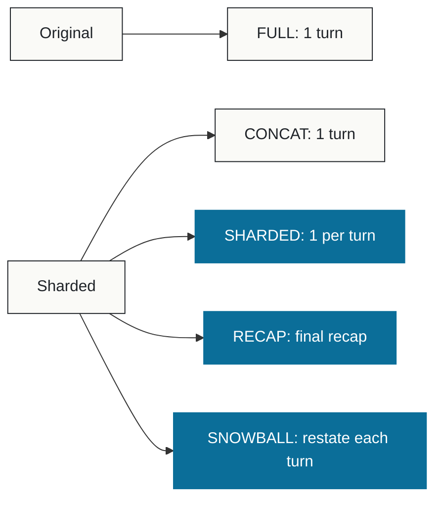
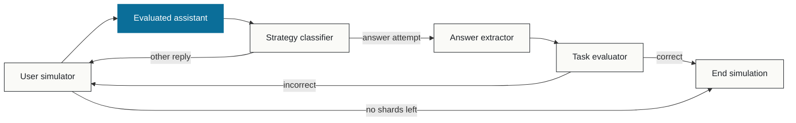

# LLMs Get Lost in Multi-Turn Conversation

Fifteen LLMs lose 39% on average when instructions arrive in pieces

<!--
Hi everyone. Today we're covering a paper by Laban and colleagues, called LLMs Get Lost in Multi-Turn Conversation. People rarely type a complete request in one go. They start with a rough idea and add details over several turns. The authors tested fifteen models on six generation tasks. Every model got worse when the details arrived in pieces, by thirty-nine percent on average. We'll go through how they tested it, what they found, and where we'd be careful. We start with a concrete example.
-->

---
layout: claim-figure
---
# A solvable math problem gets lost over turns

<SourceCaption>Laban et al., 2025, Fig. 8: Math task, Llama3.1-8B-Instruct</SourceCaption>

Performance is the task score. Across 15 LLMs and six tasks: 90% single-turn, 65% multi-turn.

<!--
Let's start with an example from the paper. This is a math task, simulated with Llama3.1-8B-Instruct. The figure shows one simulated conversation: the user turns, which add one fact at a time, and the assistant replies in between. The text inside is small, so look at the first and last user turns and see how much the problem has grown by the end. We aren't reading the replies line by line. The point is the setup. A model can solve this problem when it gets everything in one turn. Spread over turns, it is where models get lost. The numbers on the slide are averages across all fifteen models and six tasks, not this one conversation. What is performance here? It is the task score. Each task has its own evaluator, such as execution, exact match or BLEU, and for math it is whether the answer is correct. We report the averages as the paper prints them, and we don't have more detail on how scores from different tasks are combined. Average performance is ninety percent when the whole instruction comes in one turn, and sixty-five percent when the same information is spread over several turns. Real users rarely state every requirement up front. To test this, the authors needed a way to turn a normal instruction into a conversation. That's called sharding, and it's next.
-->

---
layout: claim-example
---
# Sharding gives one piece of the task per turn

<Turn who="user">what's Ara's total basketball score over four years?</Turn>
<Turn who="user">Ara has been on the school basketball team for four years now</Turn>
<Turn who="user">Ara plays 40 games per year on average</Turn>
<Turn who="user">she scores 21 points in each game</Turn>

Shards together carry the original information. Shard 1 states the intent. Computable only at turn 4.

<SourceCaption>Laban et al., 2025, p.3 and Fig. 6, sharded-GSM8K/1246</SourceCaption>

<!--
This is the idea of sharding. The authors take one fully specified instruction and split it into shards. Together, the shards carry the same information as the original. The split isn't random, and it doesn't throw anything away. The first shard always states the high-level intent, and later shards add clarifications. Who decides the split? The paper uses a four-step semi-automatic process, shown in Fig. 6. We only have its caption, which says it transforms a fully specified instruction into a sharded one. So we won't list the four steps here, and we can't say how each fact is assigned to a shard beyond that. Here's a real example from their data, a math problem with four shards. The original says Ara joined the school basketball team four years ago, has been playing forty games every year, and scores twenty-one points in every game, and it asks for the total points over four years. Turn one only asks for Ara's total basketball score over four years. Turn two adds the four years on the team. Turn three adds forty games per year on average. Turn four adds that she scores twenty-one points in each game. After turn three the problem can't be solved, so a model that answers early has to guess. In a real simulation the user simulator reveals at most one shard per turn, and the assistant replies after each one. We show only the user side. We have no assistant reply for this instance, and we won't invent one. Next, how the paper uses shards in different conditions.
-->

---
layout: claim-diagram
---
# CONCAT is the control for rephrasing

<SourceCaption>Laban et al., 2025, p.5 and Table 2. Main experiment: FULL, CONCAT, SHARDED. RECAP and SNOWBALL: 4 tasks, 2 models.</SourceCaption>

<!--
Now the five conditions. There are two starting points. One is the original instruction, and the other is the sharded version. FULL gives the original instruction in one turn. That's the baseline. From the sharded version there are four conditions. CONCAT puts all shards into one turn as bullet points. It keeps the rephrasing from sharding but removes the underspecification, so it works as a control. If a model does well on FULL and CONCAT but badly on SHARDED, the loss comes from delivering the information across turns, rather than from information lost in sharding. SHARDED is the main condition, one shard per turn. RECAP and SNOWBALL are repair attempts, the kind of repetition an agent might add. RECAP is SHARDED plus one final turn that restates all the shards. SNOWBALL restates all earlier shards at every turn, along with the new one. The main experiment uses only FULL, CONCAT and SHARDED. RECAP and SNOWBALL run on four tasks and two models, shown in Table 2, and they're in the backup. The colours separate the conditions. FULL and CONCAT are single-turn, and SHARDED, RECAP and SNOWBALL are multi-turn. Next, who plays the user in these conversations.
-->

---
layout: claim-diagram
---
# Only explicit answer attempts are scored

Clarifying or hedging replies go back to the user. 15 LLMs, six tasks, over 200,000 conversations.

<SourceCaption>After Laban et al., 2025, Fig. 3 and Table 8</SourceCaption>

<!--
Here's the loop that runs each conversation. A simulated user holds all the shards and reveals at most one per turn. The evaluated assistant, highlighted on the diagram, writes a free-text reply. A strategy classifier sorts that reply into one of seven categories, such as clarification, hedging or answer attempt. The classifier is a prompted LLM, and it gets the category descriptions from the paper's Table 8. There, an answer attempt is a complete answer that can be extracted verbatim. Hedging, meaning several candidate answers based on ifs, is its own category, and so is a clarifying question. Only an answer attempt is graded. Replies in the other categories go back to the user, who reveals the next shard. What about a partial answer? As we read the definition, a reply has to be a complete, extractable answer to count. Beyond that, we don't know how the paper handles edge cases. If the reply is an answer attempt, an answer extractor pulls it out and a task evaluator scores it. A correct answer ends the simulation. An incorrect one sends us back to the user for the next turn. The simulation also ends when no shards are left. The assistant isn't told the conversation is underspecified. The user, classifier and extractor are all LLM-based, so they can make mistakes. We'll look at the quality check on the limits slide. On scale, the authors ran fifteen LLMs on six tasks, for over two hundred thousand simulated conversations. Next, how they measure all those runs.
-->

---
layout: claim-two-figures
---
# Aptitude is best case; unreliability is spread

::left::

<SourceCaption>Laban et al., 2025, Fig. 5</SourceCaption>

::right::
Per instruction, run 10 simulations.

A90: 90th percentile score, the best case.

U: 90th minus 10th percentile score.

Average both over instructions.

<!--
This is the metric slide, so let's go slowly. For each instruction, the authors run ten simulations. The instruction and its shards stay the same. What changes between runs is sampling randomness, since the models are sampled at temperature one. That gives ten scores for one instruction. Aptitude, A90, is the ninetieth percentile of those scores. It's the best-case performance. Unreliability, U, is the ninetieth percentile minus the tenth percentile, the gap between the best and worst runs of the same instruction. Then both numbers are averaged over instructions. On the right, the figure shows this as a box plot. The definitions use only the whiskers, with the upper end marking aptitude and the whisker-to-whisker distance marking unreliability. The text we have doesn't say what the box itself marks, so we don't read anything from it. Why call the ninetieth percentile aptitude, when it sounds like picking the best runs? That's deliberate. It estimates what the model can do on a good run, which separates capability from consistency. A plain average mixes the two. So a lower mean can come from aptitude falling, from reliability falling, or from both. Unreliability is the spread across repeated runs of a single instruction. Variance across different instructions, or task difficulty, is something else. Next, the headline number.
-->

---
layout: claim-figure
---
# Every model drops on every task, by 39% on average

<SourceCaption>Our analysis, artifacts/replot-table1.csv, from Laban et al., 2025, Table 1</SourceCaption>

90% to 65% is a 25-point drop. The 39% averages each model's percentage drop. CONCAT averages 95.1% of FULL. Fig. 1 labels say -35% and -15%; the text says 39% and 16%.

<!--
Here's the headline. Every model loses performance on every task when we go from FULL to SHARDED. The grouped bars are our replot of Table 1, with models sorted by FULL score. In every group, the SHARDED bar sits below FULL. The average drop is thirty-nine percent, and that number needs care. Across models the average goes from ninety percent in FULL to sixty-five percent in SHARDED. That's a twenty-five point drop. The thirty-nine percent is relative. We read it as each model's percentage drop from FULL to SHARDED, averaged over models, and we did not recompute it. Next, the CONCAT control. CONCAT averages ninety-five point one percent of FULL, so rephrasing into shards doesn't explain the loss. The damage comes from multi-turn delivery. One warning about the paper itself. The text says thirty-nine percent and sixteen percent, but the Figure 1 labels say minus thirty-five percent and minus fifteen percent. We quote the text values and flag the figure labels as different. On our replot, the Table 1 header is garbled in the data we parsed. We read it as three setting blocks, FULL, CONCAT and SHARDED, which the dashes support but the header doesn't confirm. Next, where the drop comes from.
-->

---
layout: claim-figure
---
# Aptitude falls 16%, but unreliability rises 112%

<SourceCaption>Laban et al., 2025, Fig. 1</SourceCaption>

Best and worst runs differ by about 50 points on average. Two or more shards already cause the drop.

<!--
So where does the drop come from? The paper splits it into two parts. Aptitude is the best-case score, the average over instructions of the ninetieth percentile. Across models it falls by sixteen percent between FULL and SHARDED. The paper calls this change non-significant. We only report that wording and the number, because the text we read gives no test to show. Unreliability is the average spread between the tenth and ninetieth percentile scores. It rises by one hundred twelve percent, which is more than double. So the paper's reading is that the loss is mostly unreliability. Models can still reach a good answer on a good run, but a typical run goes much worse. How big is the spread? On average, about fifty points separate the best and worst simulated run for a fixed instruction, and every model shows very high unreliability. Another result comes from a gradual sharding experiment, which varies how finely the instruction is split. We only have its conclusion, not its setup. Two or more shards are already enough to cause the drop. It doesn't take a long conversation. Look at how little the best case moves compared with the spread. Once a model makes a wrong assumption or answers early, it tends not to recover. Now, what do the models actually do wrong?
-->

---
layout: claim-example
---
# Four behaviours explain getting lost in code

<Turn who="user">Turn digits into names in a list</Turn>
<Turn who="user">Starting with a list of numbers</Turn>
<Turn who="user">Then flip the list around</Turn>
<Turn who="user">If the list is empty, just give back an empty list</Turn>

From log reading: premature answers, reliance on earlier code, lost middle turns, verbosity. Reasoning models write 33% longer answers.

<SourceCaption>Laban et al., 2025, p.10, HumanEval code task, four of its shards</SourceCaption>

<!--
Here are four behaviours that explain how models get lost. They come from the authors' qualitative reading of simulation logs, in the appendix, not from an automated metric and not from separate experiments. How did the authors identify them? We have no coding scheme or annotation process in the text we read, so treat the list as their interpretation, and not as proven mechanisms. We show them on a real code task from HumanEval, which has eight shards. The slide shows four of them. One asks to turn digits into names in a list. Another says to start with a list of numbers. A third says to flip the list around. A fourth says what to do with an empty list. The other shards add a sort and a range filter. First, premature answers. A model that answers after turn one or two has to guess the sort, the reversal and the filter, so it bakes in assumptions. Table 6 groups conversations by when the first answer attempt comes. Average performance is thirty point nine when the attempt is earliest and sixty-four point four when it is latest. Second, reliance on earlier answers. Later shards extend or contradict those guesses, and models lean on their own earlier code. Third, loss of middle turns. Shards in the middle can be underweighted compared to the first and last. We can't separate that from middle shards simply being less important, so it stays a hypothesis. Fourth, verbosity. Longer answers likely add assumptions, according to the authors. Reasoning models write answers thirty-three percent longer on average. We don't show model outputs, because we won't invent any. Next, how this differs from earlier benchmarks.
-->

---
layout: claim-table
---
# Episodic tasks do not drop; sharded ones do

| Model | FULL | CONCAT | SHARDED |
|---|---|---|---|
| 4o-mini | 41.7 | 43.4 | 42.1 |
| 4o | 35.9 | 38.5 | 40.9 |

<SourceCaption>Laban et al., 2025, Table 4 (Translation)</SourceCaption>

Episodic: each turn is a subtask judged alone, as in MT-bench. MultiChallenge has no sharded control. Translation BLEU stays within 10% across settings.

<!--
Why call this lost, instead of simply worse? Compare with earlier work. MT-bench and its follow-ups test episodic conversations. Episodic means each turn adds a subtask that can be judged on its own, without needing the earlier turns. Single-turn and multi-turn are also scored on different task sets. MultiChallenge uses human-written realistic conversations, and it doesn't isolate underspecification with fully specified versus sharded instructions on the same tasks. This paper keeps the same underlying tasks across single-turn and multi-turn, so the degradation is measured directly, and the information has to be fused across turns. Now the control that supports the claim. The paper treats translation as episodic, because it breaks into turn-level subtasks. A fair worry is that later turns might refer back to earlier ones. We can only rely on the paper's description here. The table shows BLEU for GPT-4o-mini and GPT-4o. We read the columns as FULL, CONCAT and SHARDED. For 4o-mini it's forty-one point seven, forty-three point four, and forty-two point one. For 4o it's thirty-five point nine, thirty-eight point five, and forty point nine. BLEU stays within ten percent across settings, so there's no degradation. The multi-turn format alone doesn't cause the drop. It appears when information is underspecified across turns. Next, the limits of all this.
-->

---
layout: claim-table
---
# Simulations are simplified; models are dated

| Inspection | All Tasks |
|---|---|
| Strategy Accuracy | 95.2 |
| Extraction Success | 97.0 |
| Overall Success | 97.8 |

<SourceCaption>100 simulated sharded conversations, Laban et al., 2025, Table 5</SourceCaption>

Simulated users, minimal shards. Analytical, English, text-only tasks. Models are dated, per the ICLR award committee. Real unreliability likely higher.

<!--
Now the limits. The paper is open about them. First, the simulations are fully automated. Real users bring misunderstandings and frustration, and the simulation always reveals a new shard each turn with all needed information by the last turn. The shards are minimal, which is unrealistic and potentially adversarial. Second, scope. The tasks are analytical, in English, and text-only. We don't know whether models get lost on open-ended tasks like creative writing, in other languages, or in multimodal settings. Third, the tested models are dated. The ICLR award committee pointed this out, so newer models may behave differently. The authors expect the real-world picture to be worse, because their conditions are simplified, so the observed degradation is most likely an underestimate of unreliability. On the table, the authors inspected one hundred simulated sharded conversations. Each row is a check on the simulator. We show three of them: whether the strategy label was right, whether the answer was extracted, and overall success. We read overall success as the share of inspected conversations that passed every check, so it's ninety-seven point eight across all tasks. The text says errors were under five percent of conversations. We don't have a breakdown of the error kinds beyond these rows. So the simulator mostly works, but it uses LLM components that can err. Next, our own reading of Table 1.
-->

---
layout: claim-figure
---
# Our reading: strong and weak models drop alike

<SourceCaption>Our analysis, artifacts/replot-table1.csv, from Laban et al., 2025, Table 1</SourceCaption>

Claude 3.7 Sonnet, Gemini 2.5 and GPT-4.1 degrade 30-40%. Llama3.1-8B and Phi-4 also degrade 30-40%.

<!--
This slide is our own reading of Table 1, so these are our interpretations. We wanted to ask whether strong models escape the drop. The grouped bars compare FULL, CONCAT and SHARDED per model, sorted by FULL score. Strong models start higher, so they have more room to fall in points, while weak models have less. What we look at is the relative drop. Claude 3.7 Sonnet, Gemini 2.5 and GPT-4.1 degrade thirty to forty percent. Llama3.1-8B and Phi-4 also degrade thirty to forty percent. So a high FULL score doesn't protect a model. We can't claim a finer pattern than that. Look at the top of the chart and the bottom. The best models in FULL still end up well below their own FULL bars in SHARDED. About the data. The Table 1 header was lost when the paper was parsed, so the column order is our reading. We take three blocks of six task scores, FULL, CONCAT and SHARDED, which the dash placement supports. We did not recompute the paper's colour-coded cells. Read the values as approximate and check them against the paper's table. Next, what builders should take from this.
-->

---
layout: claim-number
---
# Builders should target multi-turn reliability

<BigNumber>39%</BigNumber>

Average drop from FULL to SHARDED across 15 models. Even at temperature 0, about 30% unreliability remains. SNOWBALL mitigates only 15-20% of the deterioration. Authors call for prioritizing multi-turn reliability.

<SourceCaption>Laban et al., 2025, p.1, p.10, p.11</SourceCaption>

<!--
What should builders take from this? All fifteen models lose thirty-nine percent on average when the instruction arrives in shards. The authors call for LLM builders to prioritize multi-turn reliability alongside single-turn aptitude. Two easy fixes only partly work. First, lowering temperature. Even when both the user and assistant temperatures are zero, about thirty percent unreliability remains. We have the table in the backup. Second, repeating information. SNOWBALL, which restates earlier shards every turn, mitigates only fifteen to twenty percent of the deterioration. RECAP helps too, but it's unrealistic because the last turn isn't known in advance. So a prompt trick or a decoding setting doesn't solve the problem. The practical point for anyone building a chat product is to test the model with information arriving over turns, and to track the gap between best and worst runs as well as the average. That's the message of the paper, with the limits we just covered in mind. Finally, a quick look at how we built this talk.
-->

---
layout: workflow
---

# This deck came from a staged pipeline with two critics and a judge from another vendor

```mermaid
flowchart LR
  classDef base fill:#FAFAF7,stroke:#1F2328,color:#1F2328
  classDef accent fill:#0B6E99,stroke:#0B6E99,color:#FFFFFF
  n0["Ingest<br/>no model"]
  class n0 base
  n1["Understand<br/>claude-sonnet-5.5<br/>5 calls"]
  class n1 base
  n0 --> n1
  n2["Analyze<br/>claude-haiku-5.5<br/>4 calls"]
  class n2 base
  n1 --> n2
  n3["Author<br/>claude-sonnet-5.5<br/>2 calls"]
  class n3 base
  n2 --> n3
  n4["Critic loop<br/>gemini-3-flash<br/>70 calls"]
  class n4 accent
  n3 --> n4
  n5["Fact-check<br/>deepseek-v4-flash<br/>16 calls"]
  class n5 base
  n4 --> n5
  n6["Judge<br/>gemini-3-flash<br/>25 calls"]
  class n6 base
  n5 --> n6
  n7["Export<br/>no model"]
  class n7 base
  n6 --> n7
```

<SourceCaption>Generated from this run's trace, artifacts/run_stats.json</SourceCaption>

::left::

- **$4.73** total cost
- **122** model calls
- **43** critic issues in the first round
- **1** critic issue in the final round

::right::

Own harness: Python state machine, PydanticAI for typed calls. 0 manual commits.

<SourceCaption>github.com/Prakhar-Tiwari-1/PAPERTRAIL-From-Paper-to-Podium</SourceCaption>

<!--
A short word on how we made this talk. We read the paper and wrote a digest with claims, terms and page anchors. From that we built a difficulty map of the hard concepts, and then a talk plan. Plots come only from the paper tables and the released dataset, with no invented values. The slides were then checked for word count, layout and plain writing. The models we used were Claude Sonnet, DeepSeek, two Gemini models and a small Qwen model run through Ollama. Every slide cites a paper figure, table or artifact file. Thanks, and we're happy to take questions. We have backups on temperature, recap, and reasoning models.
-->
---
layout: section
---
# Backup

<!--
Backup slides follow. They cover temperature, the recap fixes, and reasoning models.
-->

---
layout: claim-figure
---
# Lower temperature barely helps SHARDED

<SourceCaption>Our analysis, artifacts/replot-table3.csv, from Laban et al., 2025, Table 3</SourceCaption>

FULL and CONCAT: unreliability cut 50-80%. SHARDED: GPT-4o-mini no gain, GPT-4o 15-20%. About 30% remains at T=0.0.

<!--
Backup on temperature. In FULL and CONCAT, lowering assistant temperature cuts unreliability clearly. In SHARDED it stays high. The authors' explanation is a hypothesis from a small experiment of forty instructions and two models.
-->

---
layout: claim-table
---
# RECAP and SNOWBALL beat SHARDED but trail FULL

| Model | FULL | CONCAT | SHARDED | RECAP | SNOWBALL |
|---|---|---|---|---|---|
| 4o-mini | 86.8 | 84.4 | 50.4 | 66.5 | 61.8 |
| 4o | 93.0 | 90.9 | 59.1 | 76.6 | 65.3 |

<SourceCaption>Laban et al., 2025, Table 2</SourceCaption>

SNOWBALL mitigates 15-20% of the deterioration. RECAP is unrealistic.

<!--
Backup on repetition fixes. Both improve over SHARDED and both still lag behind FULL and CONCAT. RECAP is unrealistic because the last turn is unknown in advance.
-->

---
layout: claim-table
---
# Reasoning models drop too, with longer answers

| Task | Shortest | Longest |
|---|---|---|
| Code | 55.3 | 42.5 |
| Math | 62.9 | 56.1 |
| Average | 40.7 | 35.6 |

<SourceCaption>Laban et al., 2025, Table 7</SourceCaption>

o3 and Deepseek-R1 deteriorate like non-reasoning models. Reasoning models write answers 33% longer on average.

<!--
Backup on reasoning models. They do not escape the drop. Their answers are longer, and longer answers go with lower scores in the table. The authors say longer answers likely add assumptions.
-->
